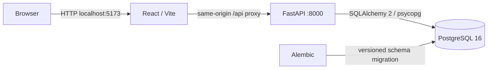
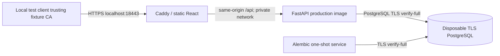

# ForgeBoard architecture

ForgeBoard is a personal-account issue tracker. A React/TypeScript SPA calls a FastAPI JSON API backed by PostgreSQL. The executable demonstration is local; Phase 3 adds production packaging and a Terraform AWS reference without creating cloud resources. The cloud budget remains R$0.

## Local process boundaries

`compose.yaml` runs PostgreSQL, the API, and the Vite development server. Only the frontend and API ports are published, bound to `127.0.0.1`. PostgreSQL stays on the internal Compose network. Database health gates API startup; API readiness gates frontend startup. The local API startup command applies `alembic upgrade head` before Uvicorn. The application itself never creates its schema at startup.

The frontend uses `/api/v1` and Vite's development proxy. The browser sees a single origin for UI and API requests; no permissive CORS configuration is needed. The Vite server is for local development and demonstrations, not a production hosting setup.

## Data and ownership

- `users`: unique normalized email, Argon2id password hash, creation timestamp.
- `sessions`: user foreign key, unique session-token hash, expiry, revocation, creation timestamp.
- `projects`: owner foreign key, name, optional description, timestamps.
- `issues`: project foreign key, title, description, status, priority, optional due date, timestamps.

Project ownership is the authorization boundary. Project reads and writes include the current authenticated user's ID in server-side queries. Issue reads and writes join through the owning project. Client-supplied user/owner IDs are never an authority. Resource access outside the current account returns the same `404` as an unknown ID. Dashboard counts and lists use the same ownership boundary.

Deleting a project permanently deletes its issues through database cascading foreign keys. The UI asks for confirmation. The MVP has no archive/trash or recovery feature. Pagination uses a bounded limit and offset, with deterministic newest-first ordering and an ID tie-breaker.

## Session and browser security

Passwords are hashed with Argon2id. Login creates a cryptographically random opaque cookie token; only its hash is persisted. Sessions expire and logout revokes the server-side session and removes the browser cookie. Session tokens are not exposed to JavaScript or stored in browser storage.

The session cookie uses `HttpOnly`, `SameSite=Lax`, and `Path=/`. `COOKIE_SECURE` defaults to true in backend configuration. The local HTTP Compose setup explicitly sets it to false; this exception must not be carried into an HTTPS deployment. There are no committed real credentials; `.env.example` contains disposable local examples.

Authenticated writes require an `X-CSRF-Token` header obtained from `GET /api/v1/auth/csrf`. The token is derived from the high-entropy session token with a purpose-specific SHA-256 hash; the server does not store another secret. The frontend keeps the CSRF value in memory and sends it with state-changing requests. All writes, including login and registration, reject a supplied `Origin` that differs from `APP_ORIGIN` and reject `Sec-Fetch-Site: cross-site`. Requests without browser metadata remain usable by API clients, but authenticated writes still require the session-bound CSRF token. CSRF complements server-side authorization; it never grants access to a resource.

## API decisions

All application endpoints are under `/api/v1`; health endpoints are `/health/live` and `/health/ready`. In development, FastAPI publishes the request/response schemas at `/docs` and `/openapi.json`; production Compose disables these endpoints. Project and issue lists return `{items, total, offset, limit}`. Issue filters are `status`, `priority`, and `search`, plus pagination. Status is `todo`, `in_progress`, or `done`; priority is `low`, `medium`, or `high`. Unknown fields, invalid lengths, invalid enum values, and invalid pagination are rejected by API schemas. Browser filter state is reflected in the URL.

Registration creates an account; login creates a session. The dashboard returns `{project_count, total_issues, todo, in_progress, done}`. Expected errors use suitable `401`, `403`, `404`, `409`, or `422` status codes without returning password hashes or session secrets.

## Verification and boundaries

API integration tests cover authentication, validation, CSRF, CRUD, filtering, pagination, dashboard ownership, and account isolation. The suite applies the real Alembic migration to a temporary SQLite database by default. `TEST_DATABASE_URL` selects a dedicated PostgreSQL test database instead; its name must end in `_test`, and the harness clears its application tables before every test. It must never target the application database. Frontend component tests cover representative forms and filter states. See the README for reproducible commands and the actual validation results from this implementation environment.

The application deliberately omits email verification/reset, external authentication, organizations, advanced rate limiting, background tasks, cloud deployment, and monitoring. Phase 2 adds software-delivery automation and security scanning, documented in [DELIVERY.md](DELIVERY.md). Its [threat model](THREAT_MODEL.md) includes contributor/CI boundaries as well as application accounts. This local MVP makes no production-readiness claim.

## Phase 2 image and dependency decisions

Application bases use immutable image digests. Python's direct requirements and resolved transitive versions are pinned through `constraints.txt`; npm uses `package-lock.json`. These pins constrain input versions, not a claim of byte-identical future builds or hashed Python wheels. Alpine security updates are applied during image builds, and all resulting images are scanned, including unfixed high/critical findings.

The backend uses Python 3.12 on Alpine with binary wheels; actual container tests validate SQLite and PostgreSQL compatibility. This removes Debian utility packages with unfixed advisories that the application does not need. The frontend updates the image's globally bundled npm separately from the application lockfile. The database derives from PostgreSQL 16.16, patches Alpine packages, and replaces Go-based `gosu` with `su-exec` while retaining the upstream entrypoint's privilege drop and initialization behavior. Compose and CI build the same database Dockerfile. Existing database volumes are retained; these changes do not delete or recreate application data.

## Phase 3 production runtime

The development and production packaging serve different purposes. `compose.yaml` remains the complete local application, including PostgreSQL and the Vite server. `compose.production.yaml` packages the same product as static React files served by Caddy plus a FastAPI runtime image; it expects a separately supplied PostgreSQL endpoint. It does not provision a database or fetch cloud credentials.

This diagram describes `scripts/production_smoke.py` and its generated local override. The helper creates its own Docker project, temporary runtime files and certificate fixtures. Caddy uses its internal issuer for the test; the Python client explicitly trusts that fixture CA. The operating system's trust store is untouched. The helper removes only its own test project and temporary files. Neither AWS nor a public ACME service is required.

The production frontend image contains built static assets and a web server, without a Node/Vite runtime. The backend runtime excludes development tools and runs as a non-root user. Compose drops capabilities, enables `no-new-privileges`, uses read-only root filesystems and bounded temporary filesystems, and sets memory/process/log limits. Only proxy ports are published and their default bind address is loopback. These constraints reduce exposed surface; they are not a substitute for patching or operational monitoring.

Caddy is built from a pinned source version with [locked Go dependencies](../infra/runtime/caddy/go.mod). This addresses high-severity dependencies found in the upstream Caddy binary while preserving the intended HTTPS/ACME behavior. A pinned Smallstep upstream commit supplies a dependency fix pending its stable release; this temporary source-build choice adds maintenance and compatibility risk. The source/dependency choices, original findings and resulting scan evidence are recorded in [PHASE3_SECURITY.md](PHASE3_SECURITY.md); scan thresholds are not weakened to accept the original binary.

The backend rejects production configuration unless `APP_ORIGIN` is HTTPS, cookies use `Secure`, and the PostgreSQL URL specifies `sslmode=verify-full` and a root CA. The runtime environment file is kept outside Git/releases; Compose injects it into backend and migration containers. The database CA is mounted read-only. Caddy serves the UI and API at one origin, sets security headers and a 64 KB request-body limit, and hides OpenAPI/schema/database-readiness paths from its public side. The API's internal readiness check still verifies the database.

Migrations are an explicit one-shot `ops` service before starting a selected release. They do not run implicitly at production API startup, and rollback never automatically downgrades the schema. Immutable image references, the previous known-good release and schema compatibility must be reviewed together. See [CLOUD_RUNBOOK.md](CLOUD_RUNBOOK.md) for the runtime contract and future recovery procedure.

## Phase 3 AWS reference decisions

The user explicitly constrained this portfolio to R$0. The roadmap therefore accepts account-free IaC validation, mocked plans and local runtime evidence instead of real cloud deployment/teardown. No AWS account, credentials, domain or paid service is a prerequisite. No real provider plan, apply, cloud release or cloud recovery exercise is claimed.

The [reference diagram](CLOUD_RUNBOOK.md#reference-architecture) maps the production packaging to one EC2 `t3.small` host and one private Single-AZ RDS PostgreSQL instance in `us-east-1`. One public app subnet permits outbound package/API access; two private DB subnets have no Internet/NAT routes. There is no inbound SSH, NAT gateway or load balancer. The database accepts port 5432 only from the application security group. This is a small reference with explicit single-host/single-database failure points, not high availability.

Two separate Terraform roots keep remote-state bootstrap distinct from the application. The proposed S3 state bucket is encrypted, versioned, private and protected from accidental deletion, with native S3 lock files. The account-free checks always use `init -backend=false`; the remote backend is never contacted. Checked-in provider lockfiles cover Linux and Windows. Tests use `mock_provider "aws"` and `command = plan` exclusively. Provider/CLI downloads require ordinary Internet access, while the tests make no AWS service calls.

RDS manages its master credential. Terraform creates application-secret metadata without its value, so no application password is passed through Terraform inputs/state. A future operator must separately create a restricted database identity and initialize that application secret. The EC2 role can read that application secret and the bounded release prefix, not the RDS master secret or remote state. IMDSv2 and a hop limit of one limit credential exposure to containers. These are source-level controls checked by mock contracts, not verified live IAM behavior.

Encrypted host/database storage, retained backups, RDS deletion protection and a required final snapshot favor data protection. A future teardown would need explicit retention decisions; stopped instances, snapshots, EIP/EBS and object versions can continue billing. The [cost estimate](CLOUD_COSTS.md) is theoretical and incompatible with the present R$0 budget, so deployment is deliberately excluded.

Real AMI/RDS-version availability, quotas, IAM execution, Session Manager, DNS/public ACME, database-user bootstrap, cloud deployment/rollback and RDS restore remain unvalidated. Local TLS tests establish certificate verification behavior, not AWS network reachability or an RDS trust-chain test. See [PHASE3_VALIDATION.md](PHASE3_VALIDATION.md) for actual executed evidence and [PORTFOLIO.md](PORTFOLIO.md) for the review walkthrough.
