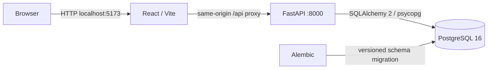

# ForgeBoard architecture

ForgeBoard Phase 1 is a personal-account issue tracker. A React/TypeScript SPA calls a FastAPI JSON API backed by PostgreSQL. There are no cloud resources or external runtime services.

## Local process boundaries

`compose.yaml` runs PostgreSQL, the API, and the Vite development server. Only the frontend and API ports are published, bound to `127.0.0.1`. PostgreSQL stays on the internal Compose network. Database health gates API startup; API readiness gates frontend startup. The local API startup command applies `alembic upgrade head` before Uvicorn. The application itself never creates its schema at startup.

The frontend uses `/api/v1` and Vite's development proxy. The browser sees a single origin for UI and API requests; no permissive CORS configuration is needed. The Vite server is for local development and demonstrations, not a production hosting setup.

## Data and ownership

- `users`: unique normalized email, Argon2id password hash, creation timestamp.
- `sessions`: user foreign key, unique session-token hash, expiry, revocation, creation timestamp.
- `projects`: owner foreign key, name, optional description, timestamps.
- `issues`: project foreign key, title, description, status, priority, optional due date, timestamps.

Project ownership is the authorization boundary. Project reads and writes include the current authenticated user's ID in server-side queries. Issue reads and writes join through the owning project. Client-supplied user/owner IDs are never an authority. Resource access outside the current account returns the same `404` as an unknown ID. Dashboard counts and lists use the same ownership boundary.

Deleting a project permanently deletes its issues through database cascading foreign keys. The UI asks for confirmation. The MVP has no archive/trash or recovery feature. Pagination uses a bounded limit and offset, with deterministic newest-first ordering and an ID tie-breaker.

## Session and browser security

Passwords are hashed with Argon2id. Login creates a cryptographically random opaque cookie token; only its hash is persisted. Sessions expire and logout revokes the server-side session and removes the browser cookie. Session tokens are not exposed to JavaScript or stored in browser storage.

The session cookie uses `HttpOnly`, `SameSite=Lax`, and `Path=/`. `COOKIE_SECURE` defaults to true in backend configuration. The local HTTP Compose setup explicitly sets it to false; this exception must not be carried into an HTTPS deployment. There are no committed real credentials; `.env.example` contains disposable local examples.

Authenticated writes require an `X-CSRF-Token` header obtained from `GET /api/v1/auth/csrf`. The token is derived from the high-entropy session token with a purpose-specific SHA-256 hash; the server does not store another secret. The frontend keeps the CSRF value in memory and sends it with state-changing requests. All writes, including login and registration, reject a supplied `Origin` that differs from `APP_ORIGIN` and reject `Sec-Fetch-Site: cross-site`. Requests without browser metadata remain usable by API clients, but authenticated writes still require the session-bound CSRF token. CSRF complements server-side authorization; it never grants access to a resource.

## API decisions

All application endpoints are under `/api/v1`; health endpoints are `/health/live` and `/health/ready`. FastAPI publishes the request/response schemas at `/docs` and `/openapi.json`. Project and issue lists return `{items, total, offset, limit}`. Issue filters are `status`, `priority`, and `search`, plus pagination. Status is `todo`, `in_progress`, or `done`; priority is `low`, `medium`, or `high`. Unknown fields, invalid lengths, invalid enum values, and invalid pagination are rejected by API schemas. Browser filter state is reflected in the URL.

Registration creates an account; login creates a session. The dashboard returns `{project_count, total_issues, todo, in_progress, done}`. Expected errors use suitable `401`, `403`, `404`, `409`, or `422` status codes without returning password hashes or session secrets.

## Verification and boundaries

API integration tests cover authentication, validation, CSRF, CRUD, filtering, pagination, dashboard ownership, and account isolation. The suite applies the real Alembic migration to a temporary SQLite database by default. `TEST_DATABASE_URL` selects a dedicated PostgreSQL test database instead; its name must end in `_test`, and the harness clears its application tables before every test. It must never target the application database. Frontend component tests cover representative forms and filter states. See the README for reproducible commands and the actual validation results from this implementation environment.

This MVP deliberately omits email verification/reset, external authentication, organizations, advanced rate limiting, background tasks, cloud deployment, CI pipelines, scanners, and monitoring. Phase 2 adds software-delivery automation and security scanning after the local demo is validated. This local MVP makes no production-readiness claim.
