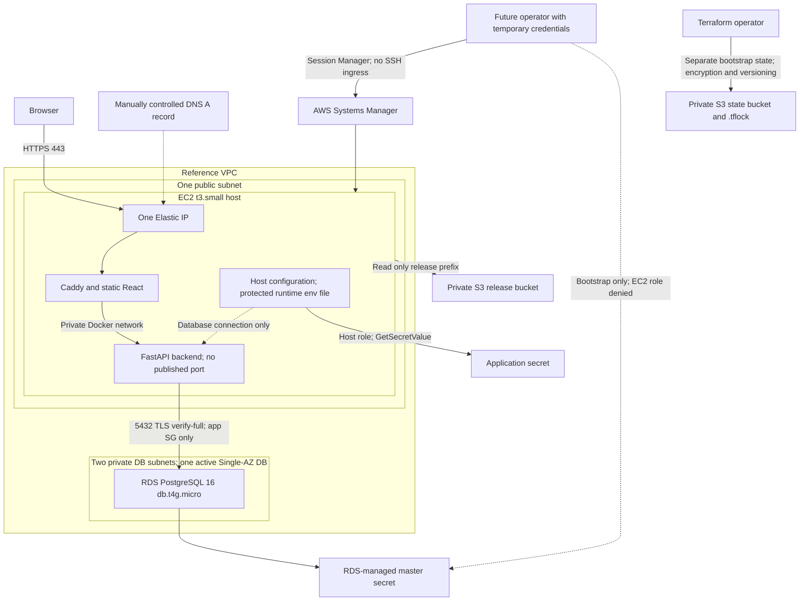

# Phase 3 infrastructure runbook

**Current budget: R$0. AWS is a reference architecture only.** This phase does not create cloud resources, open an AWS account, deploy publicly, register a domain, activate a paid subscription or use promotional credits. The deliverable is locally executable production containers, local TLS/database checks, Terraform validation/mock tests, and documented operational decisions. An AWS account, AWS credentials and a domain are not prerequisites for reproducing those checks.

Cloud apply/deploy, public certificate issuance, SSM access and RDS restore/teardown are **not executed or verified**. The future AWS sequence below explains the design and its gaps; it is outside the authorized work. See [CLOUD_COSTS.md](CLOUD_COSTS.md) for the theoretical paid estimate and [ROADMAP.md](ROADMAP.md) for the phase boundary.

## Reference architecture



The diagram describes intended AWS boundaries, not deployed assets. The EC2 host role reads the application secret and a bounded release prefix; it cannot read the master secret or Terraform state. The backend consumes its protected database environment and does not retrieve AWS secrets itself. Terraform creates the application secret's metadata only; a future operator must initialize its value outside Terraform. The database has no public endpoint. Outbound access from the app host supplies SSM/AWS APIs and package/certificate retrieval, avoiding a NAT gateway. One host plus Single-AZ RDS provides no high-availability guarantee.

## Reproduce locally without AWS

Use Terraform **1.17.2**, the provider version recorded in `infra/terraform/tool-versions.json`, and the checked-in lockfiles under `infra/terraform/`. `init -backend=false` initializes providers without contacting a real state bucket; provider/package downloads still need network access. Mock-provider tests do not use cloud credentials or create resources. Every delivered test run uses `command = plan`; none applies even mocked resources. From the repository root:

```powershell
terraform -chdir=infra/terraform/bootstrap init -backend=false -input=false -lockfile=readonly
terraform -chdir=infra/terraform/bootstrap validate
terraform -chdir=infra/terraform/bootstrap test
terraform -chdir=infra/terraform/app init -backend=false -input=false -lockfile=readonly
terraform -chdir=infra/terraform/app validate
terraform -chdir=infra/terraform/app test
terraform fmt -check -recursive infra/terraform
```

Do not replace these commands with a real `terraform plan`, `apply` or `destroy`. Tests supply fake input values and mock provider responses. They check security/configuration contracts; they do not verify a real AMI, engine availability, IAM execution, quotas or network reachability. Do not copy example account IDs/AMI IDs into a live environment.

Build the production application images and the local PostgreSQL image before running the disposable TLS check:

```powershell
docker build -f backend/Dockerfile.production -t forgeboard-backend:production backend
docker build -f frontend/Dockerfile.production -t forgeboard-frontend:production .
docker build -t forgeboard-database:local infra/postgres
python scripts/production_smoke.py
```

The smoke helper uses the production Compose file plus a generated local override. It binds only localhost, creates disposable PostgreSQL with TLS, sets Caddy's local internal issuer instead of ACME, runs Alembic explicitly, and tests the application over HTTPS. It uses its own temporary network/configuration, then removes its test containers, volumes and generated files. It does not reuse or erase the developer stack's database. The test's internal CA is a fixture, not a publicly trusted certificate or an RDS trust-chain validation.

The production environment template intentionally contains unusable image/domain placeholders. Its runtime env/CA paths must exist before Compose can resolve file mounts. `scripts/production_smoke.py` creates concrete local fixtures; running `up` directly against `.env.production.example` is not a working deployment. Check the current [validation record](PHASE3_VALIDATION.md) for exact executed commands and results.

For the standard application demo, use [README.md](../README.md)'s existing local Compose path. Production-image smoke verification complements that workflow; it does not require adopting the AWS design.

## Runtime contract and security decisions

| Input / behavior | Contract |
| --- | --- |
| `BACKEND_IMAGE`, `FRONTEND_IMAGE` | Exact reviewed image ID/digest already loaded locally; Compose uses `pull_policy: never` |
| `APP_DOMAIN`, `APP_ORIGIN` | Production hostname; backend origin is exactly `https://APP_DOMAIN`; local smoke supplies its localhost port |
| `PRODUCTION_BIND_ADDRESS` | Defaults to `127.0.0.1`; changing it to a public bind is outside this phase |
| `RUNTIME_ENV_FILE` | Host file containing application `DATABASE_URL`, loaded into the backend/migration environment through Compose's `env_file`; keep it outside Git/releases, with restricted access |
| `RDS_CA_BUNDLE` | Public trusted CA file at host `/opt/forgeboard/shared/rds-global-bundle.pem`, mounted read-only at `/run/certs/rds-global-bundle.pem` |
| Database TLS | `sslmode=verify-full` and `sslrootcert=/run/certs/rds-global-bundle.pem` in the application URL; local smoke uses its disposable fixture CA |
| HTTPS | Caddy terminates TLS; only proxy ports are published; backend remains on the Docker network |
| Authentication | Secure/HttpOnly/SameSite cookie, server-side opaque sessions, Argon2id and CSRF remain enforced by the backend |
| Migrations | `ops` profile runs Alembic once, explicitly before starting a release; no automatic downgrade |
| Runtime | Non-root images, dropped capabilities, read-only filesystems, bounded resources/log files; persistent Caddy data keeps certificate state |

OpenAPI UI/schema endpoints are disabled in production mode. Caddy redirects browser traffic to HTTPS, serves the static UI, and proxies `/api/*` to the versioned backend API. Its liveness endpoint does not expose database readiness or configuration. Public TLS would still require actual DNS and reachability; a local certificate test proves neither. [Caddy Automatic HTTPS](https://caddyserver.com/docs/automatic-https)

## Future AWS sequence — documentation only

These steps are a reference for a separately scoped future deployment. They are not an invitation to configure billing or seek an account/domain during the current R$0 execution. No cloud mutation helper, credential bootstrap helper or automated deploy/rollback script is delivered in this phase.

1. **Define the real target and review a real plan.** A future operator would provide the intended `aws_account_id`, `aws_region`, controlled hostname, reviewed AL2023 x86 AMI, supported PostgreSQL 16 minor version and unique bucket names. Temporary SSO/session credentials should replace long-lived access keys. The provider's account allowlist is a second guard, not authorization. Inspect exact add/change/destroy counts, public ingress, IAM action/resource scopes, metadata protection, encryption, backups and costs. The illustrative inventory is one EC2/root EBS/EIP, one private RDS instance, two S3 buckets, two secrets, one VPC/public subnet/two private DB subnets and purpose-specific security groups; Terraform's individual resource count is larger and must come from the actual plan.
2. **Bootstrap remote state separately.** `infra/terraform/bootstrap` begins with local state and creates the private, encrypted, versioned S3 state bucket. Preserve a protected copy before explicit migration using its `backend.tf.example` and reviewed `backend.hcl.example`. Only then initialize `infra/terraform/app` against that backend. `use_lockfile=true` supplies S3-native locking without a DynamoDB table. Lock-file access requires the documented S3 permissions. Never lose the only state copy or commit state/plans/backend credentials. [Terraform S3 backend](https://developer.hashicorp.com/terraform/language/backend/s3)
3. **Create infrastructure only under a new authorized scope.** Apply the exact reviewed plans, then independently read back SSM readiness, private RDS settings, instance profile, security groups, DNS target and actual billable inventory. A successful apply is not evidence of a working application. Current IaC has no automatic app deployment and deliberately creates no plaintext application-secret value.
4. **Initialize the least-privilege database identity.** Through an operator-only, TLS-verified SSM forwarding session, use the RDS-managed master credential to create a dedicated `forgeboard_app` role/schema. That role should have no superuser/create-role/create-database privileges and own only its application schema for Alembic. Store only its connection data in the application secret, then discard the master credential from process memory. EC2 must not gain master-secret read permission. This bootstrap procedure is not automated or live-tested here. Separating runtime DML and migration-owner roles is a later hardening choice.
5. **Prepare and verify an immutable release.** Build from a reviewed Git revision, record image IDs/digests and archive SHA-256 hashes, and retain the previous known-good release. Publish a bundle only to the intended private release prefix; record its S3 object version. Exclude `.env`, secret JSON, state, plans, personal data and developer databases. No bundled deploy script exists in the current phase.
6. **Configure the host without leaking secrets.** An operator would retrieve the exact release through SSM, verify its digest before loading it, obtain only the application secret and write a protected runtime environment file. Retrieve/review the RDS public CA bundle. Do not pass secret values in Terraform, SSM command parameters, command-line arguments or logs. Do not disable certificate verification to work around failures.
7. **Migrate and start deliberately.** On the prepared host, run the `migrate` service using the selected release, then start `backend` and `frontend`. An intended public bind would be explicit; Compose defaults to loopback. Publish the DNS A record at the EIP, remove stale unrelated AAAA records, and check inbound 80/443 plus outbound DNS/HTTPS. Public ACME issuance is separate from local internal TLS.
8. **Verify application behavior and record evidence.** Check HTTP redirect, trusted HTTPS, the Secure cookie/origin and successful readiness internally. Use disposable accounts A/B for register/login, CRUD/filter/dashboard, foreign-resource 404s, missing-CSRF 403 and logout/revoked-session rejection. Record Git revision, image/manifest/object version, migration revision, TLS result and acceptance outcome. These future results cannot be inferred from mock tests.

For a prepared local or future host with concrete image/configuration inputs, the runtime's migration/start shape is:

```powershell
docker compose --env-file release.env -f compose.production.yaml --profile ops run --rm migrate
docker compose --env-file release.env -f compose.production.yaml up -d backend frontend
```

`release.env` is not included with real values. Those commands are a runtime interface, not a complete AWS deployment recipe. The delivered local smoke script prepares equivalent disposable inputs and is the reproducible path within this phase.

## Rollback and recovery design

An application rollback should select the previous verified image/release digest, verify it again, preserve runtime secrets and Caddy data, then restart that release and rerun readiness/account-isolation checks. Rebuilding an old tag does not establish byte identity. Application rollback is an operational design here; a live cloud rollback is not claimed.

Do not automatically run Alembic downgrade when rolling back images. The earlier app may not support a newer schema. Before a destructive migration, a future operator must establish snapshot/restore behavior and compatibility. Restoring RDS creates another instance/endpoint, requires deliberate connection-secret changes and can temporarily double part of the bill. A restore drill with disposable data would be required to establish actual recovery time; no cloud restore, RTO or zero-downtime guarantee is asserted.

Local rollback can be rehearsed using two explicitly built image versions against a disposable database and the same runtime contract. Preserving the developer's database is a separate concern from the smoke helper's disposable fixtures.

## Stop and teardown boundaries

Local `docker compose stop` preserves containers/volumes. `docker compose down` removes containers/networks while retaining named volumes. Adding `--volumes` destroys that Compose project's stored data and must be intentional. The smoke helper cleans only its randomly named test project and temporary files; it does not tear down the default development project.

For a hypothetical future AWS environment, stopping services would not mean zero cost. A stopped EC2 instance retains EBS/EIP charges. RDS storage/backups remain billable while stopped; RDS automatically restarts after at most seven consecutive days. [AWS RDS stop behavior](https://docs.aws.amazon.com/AmazonRDS/latest/UserGuide/USER_StopInstance.html)

Future permanent teardown would require a reviewed destructive plan and explicit retention decisions: verify target account/environment, stop writes, retain/validate the desired final snapshot, disable only that DB's deletion protection deliberately, and destroy the application stack before considering the state stack. Versioned release objects may prevent bucket deletion; do not add unconditional force-destroy or blanket bucket-empty commands to bypass that protection. Retained snapshots, secrets pending deletion, S3 versions and state storage can continue to incur charges.

Keep remote state until the application has been removed and its state securely exported. Deleting the separate state bucket would remove version history and must never precede removal of resources whose only authoritative state it holds. This exercise has no cloud teardown step because it creates no cloud resources.

## What has and has not been demonstrated

The executable scope is local container builds, local HTTPS/PostgreSQL TLS, migrations, authentication/authorization regression checks, static IaC validation and provider-mocked contracts. Report only the checks actually recorded in [PHASE3_VALIDATION.md](PHASE3_VALIDATION.md).

Not demonstrated: a real AWS provider plan/apply, actual AMI/engine availability, AWS IAM or Session Manager execution, cloud secret bootstrap, public DNS/ACME, cloud deployment/rollback, RDS restore, billing or destructive teardown. These are intentional boundaries of the R$0 portfolio phase rather than silently reported successes.
