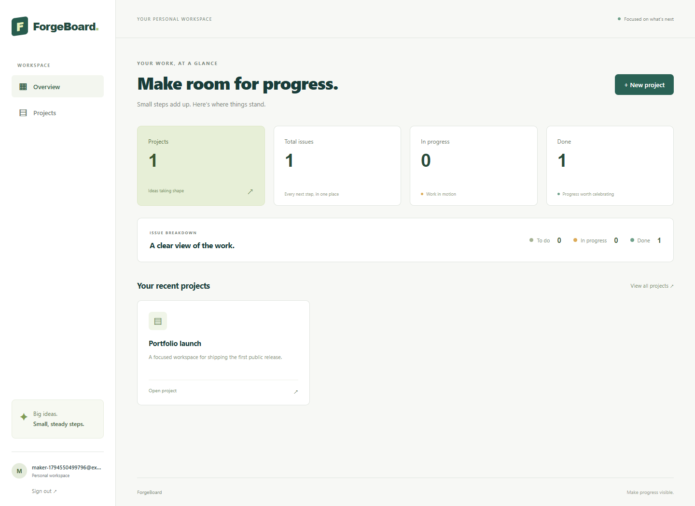
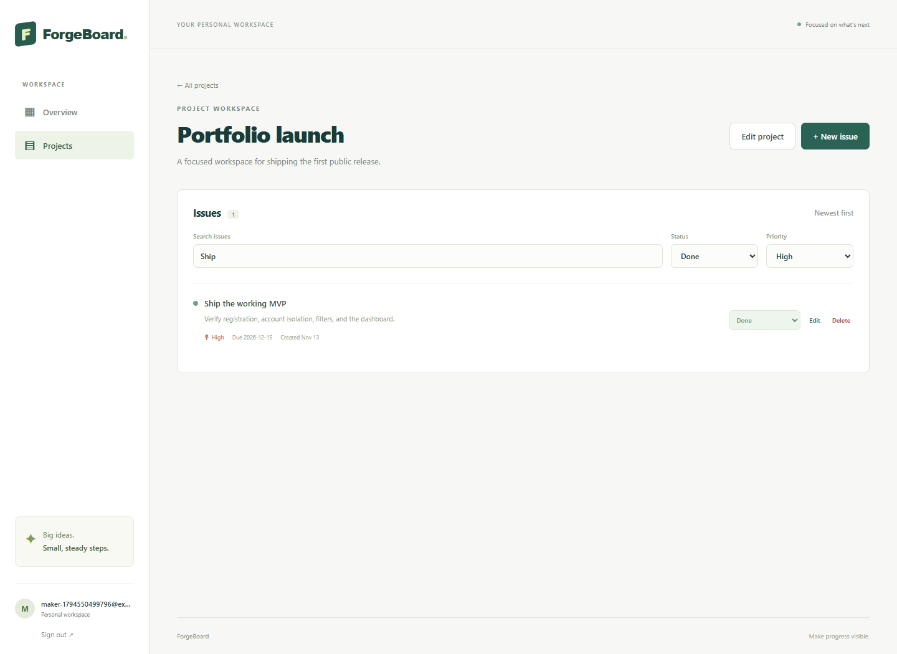
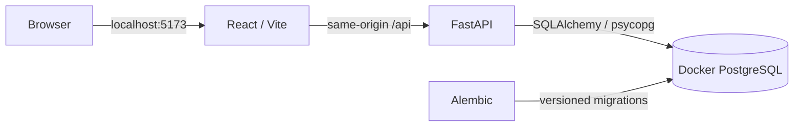
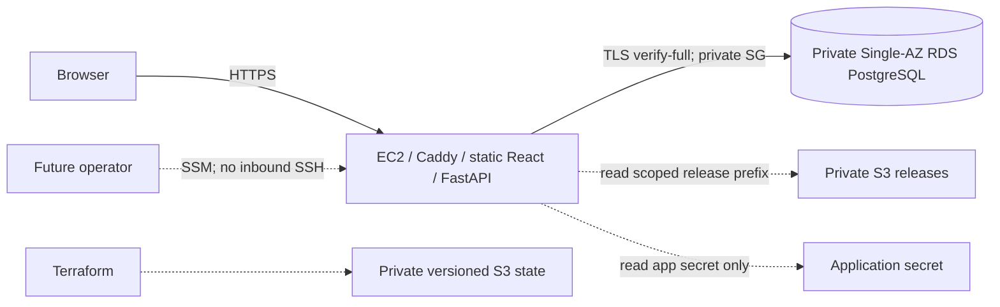

# ForgeBoard portfolio walkthrough

ForgeBoard demonstrates a working personal issue tracker, an automated delivery/security pipeline, and an infrastructure design that can be evaluated without a cloud account. **The cloud budget is R$0. AWS is reference architecture only; there is no live public application or cloud deployment to visit.** The source repository and its CI checks are public.

## Review in five minutes

1. Inspect the screenshots below for the actual UI and the [product specification](PROJECT_SPEC.md) for the intended behavior.
2. Read [ARCHITECTURE.md](ARCHITECTURE.md) for account ownership, browser sessions, development/production boundaries and the AWS design trade-offs.
3. Open [GitHub Actions](https://github.com/ehoguts/ForgeBoard/actions) and the [Phase 2](PHASE2_VALIDATION.md) / [Phase 3](PHASE3_VALIDATION.md) evidence. Check the revision and current results; a badge does not replace reviewing its logs.
4. Follow [README.md](../README.md#start-the-local-stack) to run the complete product, or its [Phase 3 commands](../README.md#phase-3-production-packaging-and-infrastructure-reference) to exercise production containers and local TLS.
5. Review the [Terraform roots and mocked plan tests](../infra/terraform/README.md), [cloud runbook](CLOUD_RUNBOOK.md) and [dated cost estimate](CLOUD_COSTS.md). No AWS credentials or resource creation is needed.

## Product demonstration

The UI supports registration/login, projects, issues, combined status/priority/search filters, URL filter state, a dashboard and logout. Data belongs to individual accounts. The API authorizes reads and writes independently of the interface.

[View the mobile dashboard capture](screenshots/dashboard-mobile.png). These are captures from the running local application using disposable demonstration data, not AWS deployment screenshots or design mockups. [scripts/browser-smoke.cjs](../scripts/browser-smoke.cjs) reproduces the browser flow and captures.

For a live local demonstration, register and log in, create a project, add issues, filter them, change a status, inspect dashboard counts and log out. Use a second browser profile to verify another account cannot see or change the first account's resources. The [README](../README.md#demonstrate-the-complete-flow) includes reproducible `404`/CSRF `403` checks.

## Engineering evidence

| Area | Implementation to inspect | Evidence / boundary |
| --- | --- | --- |
| API and persistence | [backend/app](../backend/app), [Alembic revisions](../backend/alembic/versions) | Versioned `/api/v1` schemas, SQLAlchemy queries, real schema migrations |
| Account isolation | [API tests](../backend/tests/test_api.py), [ownership architecture](ARCHITECTURE.md#data-and-ownership) | Two-account read/write tests; foreign IDs return non-disclosing `404` |
| Authentication and CSRF | [backend/app/core](../backend/app/core), [typed client](../frontend/src/api.ts), [security design](ARCHITECTURE.md#session-and-browser-security) | Argon2id, opaque HttpOnly sessions, stored token hashes, logout revocation and session-bound CSRF |
| Frontend behavior | [frontend/src/pages](../frontend/src/pages), [component tests](../frontend/src/test) | Forms, account transitions, async/error states, URL filters and responsive UI |
| Delivery and AppSec | [workflows](../.github/workflows), [report gate](../scripts/security_gate.py), [threat model](THREAT_MODEL.md) | Tests/type/lint/build, CodeQL, dependency audits and image gates; [documented failure/remediation](PHASE2_VALIDATION.md#real-failure-and-correction) |
| Production packaging | [Compose runtime](../compose.production.yaml), [proxy configuration](../infra/runtime/Caddyfile), [TLS smoke helper](../scripts/production_smoke.py) | Static UI, non-root containers, trusted local HTTPS/PostgreSQL TLS, explicit migrations and auth/isolation regressions |
| Infrastructure as Code | [Terraform modules](../infra/terraform), [infrastructure workflow](../.github/workflows/infra.yml) | Encrypted/private state design, restricted IAM and private managed DB, verified with mocked plans only |

## Two views of the architecture

The complete product demonstration runs locally:

The AWS reference would use this boundary if a separately authorized future project deployed it:

The second diagram describes code and intended controls, not running resources. The full [reference diagram and runbook](CLOUD_RUNBOOK.md#reference-architecture) explain separate database credentials, state bootstrap, explicit migration, rollback and teardown considerations. The theoretical paid estimate must not be mistaken for current spending or an approved future budget.

## Limits and next milestone

This portfolio does not claim high availability, a production security certification or a working AWS deployment. Cloud plans/apply, real IAM/SSM, public DNS/ACME and RDS restore are intentionally unexecuted. The local production smoke uses fixture certificate authorities and disposable Docker PostgreSQL. Scanners describe a dated revision/database and may report new findings later; consult the current checks and validation record.

The [roadmap](ROADMAP.md) keeps Phase 4 observability/reliability and Phase 5 product/security expansion outside Phase 3. A future deployment would require a new authorized scope and budget. The current local application, tests and architecture review remain usable without either.
