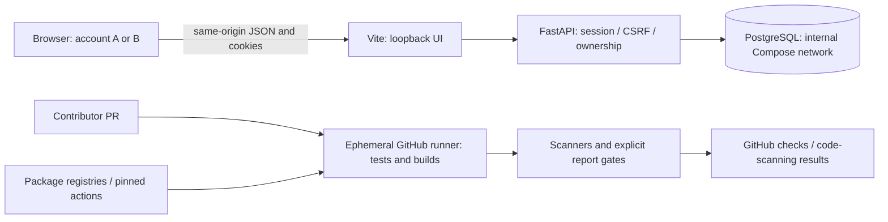

# ForgeBoard threat model

## 1. Overview

ForgeBoard is a personal-account issue tracker with a local development/demo deployment. A React SPA sends same-origin JSON requests through Vite to FastAPI; SQLAlchemy persists users, sessions, projects, and issues in PostgreSQL. Phase 2 adds delivery/security checks to the public source repository. The application itself is not publicly deployed. Scope and deployment constraints come from the user and `docs/ROADMAP.md:8`.

This model records architecture and hypothetical attacker stories, not a completed vulnerability audit. A fresh-context independent source review covered runtime/build boundaries; the model author reviewed the added workflows separately and reconciled subsequent image changes. No real environment secrets, account data, or personal browser profiles were inspected for this model.

| Component | Actual responsibility and evidence |
| --- | --- |
| Browser and Vite | Views and typed same-origin requests, cookies handled by the browser: `frontend/src/api.ts:72`, `frontend/src/api.ts:87`, `frontend/vite.config.ts:10` |
| API and sessions | JSON endpoints; Origin/Fetch Metadata checks; Argon2id, hashed opaque sessions, CSRF, expiry/revocation, scoped resource lookups: `backend/app/api.py:24`, `backend/app/main.py:17`, `backend/app/services.py:17`, `backend/app/services.py:36`, `backend/app/services.py:60`, `backend/app/services.py:80`, `backend/app/services.py:89` |
| Persistence | Versioned schema and cascading foreign keys; per-account dashboard joins: `backend/alembic/versions/0001_initial.py:9`, `backend/app/api.py:203` |
| Local images | Digest-pinned bases with system patches and non-root application users; PostgreSQL retains upstream initialization with su-exec privilege drop: `backend/Dockerfile:1`, `backend/Dockerfile:5`, `backend/Dockerfile:10`, `frontend/Dockerfile:1`, `frontend/Dockerfile:8`, `infra/postgres/Dockerfile:1`, `infra/postgres/Dockerfile:4` |
| CI and scanners | Quality/test/build jobs, CodeQL, dependency audits, image archives and explicit report gates: `.github/workflows/ci.yml:16`, `.github/workflows/codeql.yml:39`, `.github/workflows/security.yml:53`, `.github/workflows/security.yml:125`, `scripts/security_gate.py:137` |

| Deployment or workflow | Resource or capability | Configuration and safe effective location | Readers/writers and enforcing control | Evidence or unknown |
| --- | --- | --- | --- | --- |
| Compose UI/API | Browser/API listeners | Host loopback ports 5173 and 8000; Vite forwards /api to backend | Local clients; API remains authoritative | `compose.yaml:31`, `compose.yaml:48`, `frontend/vite.config.ts:10` |
| Compose database | Persistent account state | Named postgres_data volume in PostgreSQL data directory; no host port | PostgreSQL role configured from environment, trusted host/daemon operator; FK and API ownership enforce account isolation | `compose.yaml:4`, `backend/app/services.py:80`, `backend/app/services.py:89`; operators with host/DB authority are trusted |
| Host development | UI listener and DB URL | README explicitly uses Vite --host 127.0.0.1; plain npm run dev instead uses 0.0.0.0; DATABASE_URL selects the developer's DB | Trusted developer must preserve loopback and disposable test targets | `frontend/vite.config.ts:7`, `backend/app/core/config.py:7`; default Vite bind alone is not loopback isolation |
| Session/browser | Authentication and write authority | Random HttpOnly/SameSite cookie, hash stored server-side; Secure defaults true, local Compose overrides false; CSRF derived with a distinct hash prefix | Session holder, browser, API, DB; token value never exposed as JSON or stored in browser storage | `backend/app/services.py:21`, `backend/app/services.py:25`, `backend/app/services.py:36`, `backend/app/services.py:60`, `backend/app/core/config.py:10`, `compose.yaml:25` |
| Tests | Permission to clear tables | Default temporary SQLite; explicit TEST_DATABASE_URL must end in _test; CI starts a dedicated patched PostgreSQL container | Test harness deletes tables; suffix guard is not proof that a chosen remote DB is disposable | `backend/tests/conftest.py:17`, `backend/tests/conftest.py:42`, `.github/workflows/ci.yml:43` |
| CI quality/build | Execute contributor-controlled code | Disposable ubuntu-24.04 jobs, repository contents read token, checkout persist-credentials false; no push/deploy step | Runner executes package installers, tests and Dockerfiles; no deployment or registry-write secret granted | `.github/workflows/ci.yml:9`, `.github/workflows/ci.yml:109` |
| CodeQL | Upload analysis and block severe findings | Job-scoped security-events write; SARIF retained in local job workspace; explicit score >=7 gate | GitHub CodeQL actions; fork token restrictions still apply; no pull_request_target | `.github/workflows/codeql.yml:39`, `.github/workflows/codeql.yml:61`, `.github/workflows/codeql.yml:68`; actual repository merge enforcement must be verified separately |
| Dependency/image analysis | Supply-chain input, advisory data and reports | Python constraints, npm lock, digest-pinned bases/actions/Trivy; Trivy reads a tar with no Docker socket, read-only root, dropped capabilities, separate writable reports | Registries/advisory feeds and GitHub runner; report parse/tool/network errors fail closed; reports uploaded only on default branch for 7 days | `backend/requirements.txt:1`, `backend/constraints.txt:1`, `frontend/package-lock.json:1`, `.github/workflows/security.yml:114`, `.github/workflows/security.yml:162`, `.github/workflows/security.yml:177`, `scripts/security_gate.py:15` |

## 2. Threat model, trust boundaries, and assumptions

Protected assets are account passwords and session authority, private project/issue data, database integrity/availability, source and dependency integrity, and CI check/report integrity. Anonymous visitors and authenticated account B may send arbitrary HTTP input and resource IDs, but do not possess account A's session/CSRF token. A malicious site may cause browser requests but cannot normally read same-origin responses. Contributors control PR source, tests, dependency inputs and Dockerfile changes; executing their code on an isolated runner is intended, not itself a privilege escalation. They must not obtain deployment credentials, host authority, or an unrestricted write token. Package/advisory services are external supply-chain dependencies; the maintainer, local host, Docker daemon and DB administrator are trusted.

Invariants: passwords use Argon2id; sessions expire/revoke and store only token hashes; every resource/list/count is scoped server-side; authenticated writes require CSRF and browser metadata is checked; text is escaped by React and ORM parameters remain data. The frontend cache is not an authorization boundary. Account transitions discard private cached queries (`frontend/src/session.ts:4`). Image/source scan success alone does not establish exploitability, production readiness, or merge-policy enforcement.

Supported deployment is local-only. Direct API clients may omit Origin/Fetch Metadata, but authenticated writes still require the session-bound CSRF header. No email verification/reset, shared organizations, public TLS/rate controls, deployment credentials or production service is assumed. Python constraints pin resolved versions, not wheel hashes; system package upgrades deliberately change with available patches, so byte-identical builds are not promised. Revisit the model before public exposure, new imports/sharing, new privileged CI steps or deployment authority.

## 3. Attack surface, mitigations, and attacker stories

These are prioritized hypotheses. Scanner findings and their remediation are separately recorded in PHASE2_VALIDATION.md; no story below is asserted as a confirmed application vulnerability.

| Priority | Scenario and capability gain | Prerequisites and impact | Existing controls | Mitigation / remaining evidence | Evidence |
| --- | --- | --- | --- | --- | --- |
| P1 | Account B reads or modifies A's resource through an ID, nested list/create or dashboard | B has only its own session; failure would cross an account confidentiality/integrity boundary | Scoped project query and issue/project join; dashboard owner filter; foreign resources return 404 | Preserve cross-account tests across every route and future schema changes | `backend/app/services.py:80`, `backend/app/services.py:89`, `backend/app/api.py:203`, `backend/tests/test_api.py:171` |
| P1 | Stolen/replayed session or password database grants account authority | Token disclosure, weak password hash, or accepted revoked/expired token required | Argon2id, random token, hashed persistence, HttpOnly/SameSite, expiry/rotation/revocation | Preserve secret-free logs/artifacts; use Secure/TLS before external exposure | `backend/app/services.py:17`, `backend/app/services.py:36`, `backend/app/services.py:60` |
| P2 | Attacker site changes victim state or forces a login session | Browser sends credentials across an origin boundary | CSRF header, Origin/Fetch Metadata rejection, SameSite | Preserve login/register origin tests and CSRF malformed/session-bound tests; verify new unsafe endpoints | `backend/app/main.py:17`, `backend/app/services.py:60` |
| P2 | Project/issue input becomes SQL or active script | Injection sink or unsafe HTML rendering would be required | Pydantic limits/unknown-field rejection, parameterized ORM, React text rendering | Do not introduce raw HTML, string-built SQL, external imports, or unsafe renderers without review | `backend/app/schemas.py:16`, `backend/app/api.py:48`, `frontend/src/pages/ProjectDetail.tsx:188` |
| P1-P2 | Contributor-controlled workflow/dependency obtains more authority than intended | A secret/write-capable context, compromised action/package or unsafe PR trigger is required | Read-only checkout, pinned action SHAs, no pull_request_target, no deployment or publication; explicit scanner gates | Review workflow/gate/lock updates; verify required checks on main; source already controlled by the same PR actor is not a new leak | `.github/workflows/ci.yml:9`, `.github/workflows/codeql.yml:39`, `.github/workflows/security.yml:16` |
| P2 | Missing/corrupt scanner output appears clean, or reports include sensitive state | Ignored tool errors, invalid metadata or broad artifact paths | Regression-tested fail-closed gate; archives rather than socket; narrow default-branch report retention | Preserve parser/boundary tests; never add blanket ignore flags; verify gate changes in review | `scripts/security_gate.py:15`, `scripts/security_gate.py:22`, `scripts/security_gate.py:43`, `scripts/security_gate.py:66`, `scripts/security_gate.py:86`, `.github/workflows/security.yml:162` |
| P3 | Test cleanup deletes valuable data | Trusted operator chooses an unsafe server/DB still named _test | Temporary SQLite default, explicit suffix guard, dedicated CI database | Confirm server/account/DB before manual runs; suffix alone is insufficient | `backend/tests/conftest.py:17`, `backend/tests/conftest.py:42` |
| Conditional P1-P2 | Local HTTP/Vite becomes externally reachable; resource exhaustion or transport theft follows | Broader bind/proxy/public deployment than supported | Compose loopback; Secure cookie default outside local override; bounded inputs | Before exposure add TLS, rate/resource controls and revisit session lifecycle; no public runtime exposure is established | `compose.yaml:31`, `compose.yaml:48`, `frontend/vite.config.ts:7` |

## 4. Severity calibration

**Critical:** a demonstrated unauthenticated systemic account bypass, or code execution acquiring significant trusted service/CI/deployment authority. A package's critical advisory label alone does not establish that application impact or a public service exists.

**High:** concrete cross-account data read/write, accepted replay of a known revoked session, or contributor-controlled input acquiring a meaningful secret/write capability. Running a PR's own test code under its existing isolated authority is a counterexample.

**Medium:** constrained data/integrity loss with established prerequisites, or significant availability loss on an actually exposed service. CSRF assessment must account for the session-bound header and Origin/Fetch Metadata/SameSite controls together.

**Low:** limited information exposure or defense-in-depth weakness without a strong authority crossing. A host/DB administrator selecting an executable or reading state they already control gains no new capability.

Confidence and impact are separate. Keep missing deployment/reachability/repository-setting evidence explicit. Passing tests and scans do not prove absence of vulnerabilities. Repository merge controls and final hosted executions are evidenced separately in the delivery/validation documents.
