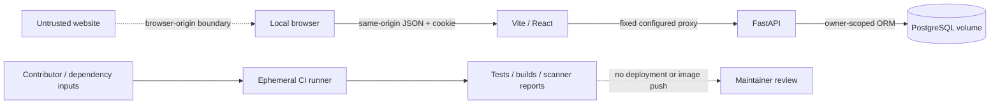

# ForgeBoard threat model

## 1. Overview

ForgeBoard is a personal-account issue tracker. The supported deployment is a local development/demo stack, not a public production service. A React SPA sends same-origin JSON requests through Vite to FastAPI; SQLAlchemy persists users, sessions, projects, and issues in PostgreSQL. Phase 2 adds GitHub Actions quality/build and security checks without publishing images or deploying the application. The scope and absence of paid cloud/public deployment come from the user's request and `docs/ROADMAP.md:8`.

This document records architecture facts and threat scenarios. Scenarios below are hypotheses to guide review, not confirmed vulnerabilities or a claim of complete audit coverage. A separate fresh-context architecture review checked runtime/build boundaries; the model author verified the subsequently added CI files directly. No real `.env` values, credentials, application database contents, or personal browser profiles were read for this model.

| Component | Responsibility | Source evidence |
| --- | --- | --- |
| React/Vite | Views, same-origin API client, in-memory account state | `frontend/src/api.ts:84`, `frontend/src/App.tsx:12`, `frontend/vite.config.ts:10` |
| FastAPI | Versioned endpoints, origin checks, health, account/session dependencies | `backend/app/api.py:24`, `backend/app/main.py:16` |
| Session service | Argon2id, opaque tokens, CSRF, expiry/revocation, ownership lookups | `backend/app/services.py:17`, `backend/app/services.py:36`, `backend/app/services.py:60`, `backend/app/services.py:80` |
| SQLAlchemy/Alembic | Database access and versioned schema | `backend/app/db.py:13`, `backend/alembic/env.py:13`, `backend/alembic/versions/0001_initial.py:9` |
| Containers | Separate build contexts and non-root application users | `compose.yaml:18`, `compose.yaml:40`, `backend/Dockerfile:8`, `frontend/Dockerfile:7` |
| GitHub workflows | Tests, types, lint, container builds, source/dependency/image analysis | `.github/workflows/ci.yml:16`, `.github/workflows/codeql.yml:18`, `.github/workflows/security.yml:23` |

### Effective resources and authority

These are source-established effective values under the stated startup path. Host firewall behavior, actual environment overrides, filesystem permissions, GitHub repository settings, and database role grants remain deployment facts to verify.

| Deployment or workflow | Resource or capability | Configuration and precedence | Safe effective value or location | Readers, writers, or recipients | Enforcing control | Evidence or unknowns |
| --- | --- | --- | --- | --- | --- | --- |
| Compose | API listener | Compose Uvicorn command, then published-port mapping | Container `0.0.0.0:8000`; host `127.0.0.1:8000` | Host clients and Compose peers | Docker host mapping; application authentication remains separate | `compose.yaml:27`, `compose.yaml:29` |
| Compose | UI listener / proxy | Vite binds all container interfaces; Compose publishes loopback and sets `API_PROXY_TARGET` | Host `127.0.0.1:5173`; `/api` → `http://backend:8000` | Local browser and API container | Loopback host mapping; configured fixed proxy destination | `frontend/vite.config.ts:7`, `frontend/vite.config.ts:11`, `compose.yaml:44`, `compose.yaml:46` |
| Native host | UI/API listeners / proxy | README passes Uvicorn `--host 127.0.0.1`, sets proxy target, and overrides Vite CLI host | UI `127.0.0.1:5173`; API `127.0.0.1:8000` | Host clients | Explicit invocation and host network controls | `README.md:100`, `README.md:108`, `README.md:109`; plain `npm run dev` instead binds `0.0.0.0` (`frontend/package.json:7`) |
| Compose | Database connection | Compose interpolates `POSTGRES_*` into backend `DATABASE_URL`; Settings consumes process environment | psycopg connection to `database:5432`; configured application database; credential is the `POSTGRES_PASSWORD` reference | API, Alembic, database service | PostgreSQL authentication and Compose network; no database port published | `compose.yaml:4`, `compose.yaml:22`, `backend/app/core/config.py:7`, `backend/app/db.py:13` |
| Compose | Persistent database files | Project name plus named volume mapped into PostgreSQL | `forgeboard_postgres_data` → container `/var/lib/postgresql/data` | PostgreSQL and Docker host administrators | Docker volume/host permissions | `compose.yaml:1`, `compose.yaml:10`, `compose.yaml:57`; physical host backing path not established from source |
| Native host | Database connection / migration authority | Terminal `DATABASE_URL`, otherwise Settings fallback; no automatic root `.env` loading | Documented loopback PostgreSQL at port 5432; developer-selected role/database | Local API/migration process | Operator-created role, listener, and database grants | `README.md:87`, `README.md:95`, `backend/app/core/config.py:7`, `backend/alembic/env.py:13` |
| Browser session | Cookie and server session | `COOKIE_SECURE` / TTL → Settings → cookie and database row | `forgeboard_session`; HttpOnly, SameSite=Lax, Path=/, no explicit Domain; default absolute lifetime 24 hours | Raw token in browser cookie jar; hash/lifecycle in sessions table | Browser attributes plus server hash lookup, expiry, revocation | `backend/app/core/config.py:10`, `backend/app/services.py:45`, `backend/app/services.py:49`, `backend/app/services.py:60`; Compose explicitly overrides Secure to false for localhost HTTP (`compose.yaml:23`) |
| Browser writes | Origin / CSRF authority | `APP_ORIGIN` defaults to localhost UI; session cookie derives purpose-specific CSRF token | Supplied Origin must equal `http://localhost:5173`; authenticated unsafe methods require session-bound `X-CSRF-Token` | Middleware, session dependency, request-local browser memory | Exact Origin / Fetch Metadata rejection and constant-time CSRF comparison | `backend/app/main.py:21`, `backend/app/services.py:25`, `backend/app/services.py:69`, `frontend/src/api.ts:78` |
| Default pytest | Migration and row deletion | No `TEST_DATABASE_URL` → temporary directory → overwrite `DATABASE_URL` before application import | `<OS temp>/forgeboard-tests-*/forgeboard_test.db` | Test process and imported application engine | Generated temporary file, Alembic, cleanup/disposal | `backend/tests/conftest.py:15`, `backend/tests/conftest.py:22`, `backend/tests/conftest.py:24`, `backend/tests/conftest.py:35` |
| Explicit PostgreSQL pytest | Migration and row deletion | Operator-supplied `TEST_DATABASE_URL`; parsed database name must end `_test` | Operator-selected test server/database; CI chooses loopback `forgeboard_test` | Test process and selected database | Suffix guard; CI service isolation; operator must verify resource ownership | `backend/tests/conftest.py:16`, `backend/tests/conftest.py:19`, `backend/tests/conftest.py:43`, `.github/workflows/ci.yml:24`; suffix alone does not prove disposability |
| Image builds | Install scripts, source, runtime authority | Service-specific contexts; pip requirements plus Linux/Python 3.12 constraints or npm lock, then copy and runtime USER | Backend `/app` as `app`; frontend `/app` as `node`; build installation initially runs with builder authority | Package providers, Docker builder, application process | Context `.dockerignore`, resolved Python version constraints/npm lock, non-root runtime | `backend/requirements.txt:1`, `backend/constraints.txt:1`, `backend/Dockerfile:3`, `backend/Dockerfile:8`, `frontend/Dockerfile:3`, `frontend/Dockerfile:7`, `backend/.dockerignore:8`, `frontend/.dockerignore:5`; Python constraints are not wheel hashes or proof of all-platform reproducibility |
| CI quality/build | Execute contributor code and dependency scripts | PR/push/dispatch; hosted Ubuntu jobs; immutable action references | Ephemeral runner; dedicated PostgreSQL service; local container images only | Runner and package/action providers | `contents: read`, no persisted checkout credentials, job timeouts, no image push | `.github/workflows/ci.yml:3`, `.github/workflows/ci.yml:9`, `.github/workflows/ci.yml:45`, `.github/workflows/ci.yml:104` |
| CodeQL | Source extraction, security-report write | Eligibility check, language matrix, build-mode none; analyze job permission override | Python/JavaScript analysis; SARIF under ignored `.local/codeql-results`; reports retained 7 days only from default branch | GitHub code scanning and artifact readers permitted by repository settings | Only analysis job has `security-events: write`; SHA-pinned actions; explicit SARIF gate | `.github/workflows/codeql.yml:19`, `.github/workflows/codeql.yml:39`, `.github/workflows/codeql.yml:56`, `.github/workflows/codeql.yml:69`; repository entitlement, actual runs, and branch rules are external |
| Dependency audit | Advisory lookup / package installation / JSON reports | Pinned audit tooling; constrained Python requirements and npm lock; CLI reports validated by the shared gate | Package coordinates queried against advisory services; ignored `.local/security` reports | Hosted runner, package/advisory services, default-branch artifact readers | Read-only repository token; no application credentials; nonzero tool/network errors are not treated as a clean scan | `.github/workflows/security.yml:53`, `.github/workflows/security.yml:72`, `.github/workflows/security.yml:77`, `.github/workflows/security.yml:94`, `infra/security-requirements.txt:2` |
| Image audit | Parse local image archive, download vulnerability database, write reports | Matrix selects backend/frontend/database; image is built/pulled and exported; scanner image fixed by digest | Archive mounted read-only at `/input/image.tar`; write-only purpose report area `/reports`; temporary cache `/tmp/trivy-cache` | Docker daemon on runner, isolated scanner container, vulnerability-feed services, artifact readers | Scanner receives no Docker socket; read-only root filesystem, dropped capabilities, no-new-privileges, separate report mount | `.github/workflows/security.yml:123`, `.github/workflows/security.yml:133`, `.github/workflows/security.yml:145`, `.github/workflows/security.yml:162` |
| Security enforcement / demonstration | Block findings and prove failure behavior | Shared JSON/SARIF gate; boolean manual-dispatch exercise | Missing/invalid report or scanner error blocks; synthetic HIGH fixture deliberately returns failure without vulnerable application code | CI checks and maintainers | Tests cover severity boundaries; dependency/image report uploads restricted to default branch and 7-day retention | `scripts/security_gate.py:15`, `scripts/security_gate.py:139`, `scripts/tests/test_security_gate.py:15`, `.github/workflows/security.yml:24`, `.github/workflows/security.yml:112`, `.github/workflows/security.yml:177` |
| Optional browser QA | Developer-selected executable/module and local data mutation | `PLAYWRIGHT_MODULE` / `BROWSER_PATH` overrides; otherwise ignored local QA tooling | Localhost:5173 app; screenshots under `docs/screenshots/`; disposable accounts in the running application | Developer process, browser, current local app | Trusted developer invocation and separate browser contexts; not pytest's temporary database | `scripts/browser-smoke.cjs:5`, `scripts/browser-smoke.cjs:11`, `scripts/browser-smoke.cjs:24`, `scripts/browser-smoke.cjs:126` |

## 2. Threat model, trust boundaries, and assumptions

Protected assets are private project/issue data and counts, account identity/password hashes, raw session tokens, database connection authority and persistence, source/dependency/build integrity, CI permissions, and the correctness of security evidence. API output schemas expose account identity without password hashes (`backend/app/schemas.py:35`). Session persistence stores a token hash with expiry/revocation rather than a replayable raw cookie (`backend/app/models.py:22`).

An unauthenticated reachable client controls request paths, JSON, filters, and headers, but starts without another account's password, session, CSRF value, or database credentials. An authenticated account additionally controls its own project/issue text and resource IDs; it must never gain another owner's authority. A malicious website can induce browser requests but does not inherently read an HttpOnly cookie or a same-origin CSRF response. A PR author/dependency provider may influence code executed by CI; executing their own tests is expected behavior, while access to trusted secrets/write authority would be a new capability. Host administrators, trusted developer environment variables, Docker daemon control, and repository administrators are not treated as lower-privileged web users.

The principal boundaries and invariants are:

- **Credentials → session.** Bounded credential schemas feed Argon2id hashing/verification. Registration creates an account; login issues the session. Authentication rejects invalid, expired, or revoked sessions and rotates a presented prior cookie; logout revokes the row (`backend/app/schemas.py:18`, `backend/app/api.py:47`, `backend/app/api.py:59`, `backend/app/services.py:36`, `backend/app/api.py:79`).
- **Browser origin → state change.** Login/register and authenticated writes reject mismatched supplied Origin or cross-site Fetch Metadata. Authenticated unsafe operations independently require the session-bound CSRF token. API clients may omit browser metadata, which does not bypass the authenticated CSRF requirement (`backend/app/main.py:21`, `backend/app/services.py:69`, `backend/app/api.py:74`). CSRF is not intended to repair a stolen valid session.
- **Account → resource.** Current identity comes from the server-side session; projects filter owner ID and issues join through the project. Nested operations first authorize the project, and dashboard aggregation uses the same owner boundary. Unknown fields cannot introduce owner/user reassignment (`backend/app/api.py:35`, `backend/app/services.py:80`, `backend/app/services.py:89`, `backend/app/api.py:146`, `backend/app/api.py:175`, `backend/app/api.py:205`, `backend/app/schemas.py:14`).
- **Untrusted text → database/DOM.** ORM expressions are parameterized; LIKE metacharacters are escaped for literal search. React renders project/issue text in JSX, not an HTML interpreter. Private response data is in memory; transitions discard private query cache (`backend/app/api.py:155`, `frontend/src/pages/ProjectDetail.tsx:108`, `frontend/src/pages/ProjectDetail.tsx:206`, `frontend/src/pages/ProjectDetail.tsx:209`, `frontend/src/session.ts:4`, `frontend/src/App.tsx:14`).
- **Untrusted contribution → delivery authority.** Tests/builds run repository and dependency code in hosted jobs with minimal token permissions. No `pull_request_target`, image publication, or deployment is present in the inspected workflows. CodeQL's report-writing permission is distinct from checkout/read-only CI authority (`.github/workflows/ci.yml:9`, `.github/workflows/ci.yml:47`, `.github/workflows/ci.yml:118`, `.github/workflows/codeql.yml:39`).
- **Scanner input → security decision/evidence.** A scan must complete and produce a report accepted by the shared gate. The current policy blocks every pip-audit advisory, npm high/critical findings, Trivy HIGH/CRITICAL findings including unfixed entries, and CodeQL security scores at least 7. Reports are not suppressed by a global ignore or continue-on-error switch. Image scanning reads an archive without running the application or mounting the Docker socket; advisory services and scanner parsers remain distinct trusted dependencies (`scripts/security_gate.py:22`, `scripts/security_gate.py:42`, `scripts/security_gate.py:63`, `scripts/security_gate.py:80`, `.github/workflows/security.yml:162`). A green workflow only means the configured checks passed for that revision/feed; repository merge rules and artifact visibility are external settings to verify.

Deployment assumptions remain explicit. Local HTTP explains the non-Secure cookie override; a future HTTPS/public deployment must revisit it. Vite is not intrinsically loopback-only: the documented container mapping or native CLI override provides that restriction. The same database authority currently runs application queries and migrations; least-privilege grants are not established by these files. A `_test` suffix is only a guard, not proof of a disposable server. Dependency feeds, registries, Docker/GitHub infrastructure, browser security semantics, and operator-controlled configuration remain trusted external dependencies. Advanced rate limiting, password reset/email verification, public TLS, cloud provisioning, organizations, and RBAC are deliberately outside this delivery phase.

## 3. Attack surface, mitigations, and attacker stories

The following are prioritized **hypothetical failure stories**. They require review or reproduction before being called findings. Existing control evidence is counterevidence to a claimed bypass.

| Priority | Scenario and capability gain | Prerequisites | Impact | Existing controls | Mitigation | Evidence |
| --- | --- | --- | --- | --- | --- | --- |
| P1 | Account A supplies B's project/issue UUID to read, mutate, create nested data, or infer private counts | A has only its own valid session/CSRF | Cross-account confidentiality/integrity loss | Owner-scoped lookups, issue/project join, scoped dashboard, non-disclosing 404 | Preserve the server boundary on every new route; keep negative tests for reads/writes/counts | `backend/app/services.py:80`, `backend/app/services.py:89`, `backend/app/api.py:205`, `backend/tests/test_api.py:182` |
| P1 | A stolen raw session remains usable after logout or expiry | Separate token theft plus lifecycle failure | Account impersonation | Random opaque cookie, hash-only persistence, absolute expiry, revocation/rotation | Keep replay/lifecycle tests; require HTTPS/Secure cookies before any public deployment | `backend/app/services.py:45`, `backend/app/services.py:60`, `backend/app/api.py:79`, `backend/tests/test_api.py:34`, `backend/tests/test_api.py:78` |
| P1 | PR/dependency code uses a trusted runner token or secret to alter repository/security state | A workflow grants additional authority beyond executing contributor code | Source/report tampering or secret disclosure | Read-only default permissions, checkout credentials not persisted, no privileged PR-target event, bounded hosted jobs | Keep write permissions job-local, no deployment secrets in PR jobs, review pinned-action/dependency updates and artifact consumers | `.github/workflows/ci.yml:9`, `.github/workflows/ci.yml:47`, `.github/workflows/codeql.yml:39` |
| P2 | A foreign website causes a victim's authenticated write or forces a login state | Victim browser can reach local app; browser-origin or CSRF control fails | Unauthorized account state changes | Origin/Fetch Metadata checks; independent session-bound header on authenticated unsafe methods | Preserve both controls; retest null/mismatched Origin and missing/wrong/session-mismatched CSRF | `backend/app/main.py:21`, `backend/app/services.py:69`, `backend/tests/test_api.py:94`, `backend/tests/test_api.py:109` |
| P2 | User text becomes SQL or executable HTML | A future route bypasses ORM/schema/rendering conventions; cross-account impact additionally needs a victim-readable content path | Database disclosure or same-origin script authority | Typed/extra-forbid input, parameterized ORM, ordinary JSX text | Avoid raw SQL/string HTML sinks; review any markdown/export/sharing feature as a new boundary | `backend/app/schemas.py:14`, `backend/app/api.py:155`, `frontend/src/pages/ProjectDetail.tsx:206`; current personal-account self-content is not itself a cross-account exploit |
| P2 | A stale dependency/base image or compromised package executes during install/build or at runtime | Vulnerable reachable path or supplier compromise; build execution differs from runtime exposure | Runner/container compromise, depending on authority | Python resolved-version constraints, npm lock, immutable action pins, non-root application users and limited contexts | Triage installed versions/advisories and reachability; refresh reviewed inputs and verify scanner failures are not ignored; PyPI/registry trust remains necessary without wheel/content verification | `backend/requirements.txt:1`, `backend/constraints.txt:1`, `frontend/package-lock.json:1`, `backend/Dockerfile:5`, `frontend/Dockerfile:4`, `.github/dependabot.yml:3` |
| P2 | A scanner/report error is mistaken for a clean result, or reports leak sensitive content | Missing/invalid output, ignored exit code, excessive artifact path/visibility | False security assurance or unintended source/secret disclosure | Shared gate checks reports/severity; CLI failures block; reports retained only from default branch for 7 days; scanner receives archive rather than Docker socket | Preserve malformed/error/boundary tests, keep narrow upload paths and retention, verify repository access/merge rules; never upload `.env` or session material | `scripts/security_gate.py:15`, `scripts/security_gate.py:139`, `.github/workflows/security.yml:85`, `.github/workflows/security.yml:112`, `.github/workflows/security.yml:162`, `.github/workflows/codeql.yml:69` |
| P3 | The developer points a test cleanup command at valuable data | Trusted operator misconfiguration; chosen DB name still ends `_test` | Destruction in selected test database | Temporary SQLite default; suffix guard; dedicated CI service | Verify server/account/DB before explicit test runs; never infer safety from suffix alone | `backend/tests/conftest.py:19`, `backend/tests/conftest.py:43`, `.github/workflows/ci.yml:24` |
| P3 / conditional P1-P2 | Local HTTP/Vite is exposed to an untrusted network; repeated credential hashing exhausts resources or transport exposes sessions | A broader bind/publish/proxy/public deployment than the documented setup | Availability loss or token disclosure | Compose loopback mapping, cookie Secure default outside local override; bounded field lengths | Keep local-only invocation; before exposure add TLS, resource/rate controls and revisit authentication lifecycle | `compose.yaml:23`, `compose.yaml:29`, `compose.yaml:46`, `frontend/vite.config.ts:7`, `backend/app/schemas.py:18`; no public deployment is established |

## 4. Severity calibration

- **Critical:** plausible unauthenticated broad compromise with a demonstrated reachable path, such as arbitrary code execution holding significant trusted CI/deployment authority, or systemic authentication/ownership bypass across accounts. A package advisory labeled critical is not sufficient without understanding the installed target and capability gain. This repository has no production deployment authority to assume.
- **High:** demonstrated arbitrary cross-account project/issue read/write, replay of a known revoked session, or a contributor-controlled workflow obtaining a meaningful write token/secret. Source/data already available to the same actor is a counterexample; expected execution of a PR's own tests alone is not privilege escalation.
- **Medium:** constrained integrity/confidentiality loss with concrete prerequisites, or meaningful availability loss on an actually exposed service. CSRF claims must account for Origin/Fetch Metadata, SameSite, and the session-bound header; a hypothetical public deployment does not prove current public reachability.
- **Low:** limited-impact information exposure or defense-in-depth weakness without crossing a strong authority boundary. An operator already controlling the host, trusted configuration, database administration, or browser executable selection does not gain a new capability merely by exercising it.

Confidence and severity are separate. Record missing reachability, environment, scanner, or repository-setting evidence explicitly. Neither passing tests nor this model establishes the absence of vulnerabilities. Revisit this document when new sharing/import/rendering routes, token scopes, publication/deployment steps, public exposure, or data-store authority are introduced.
